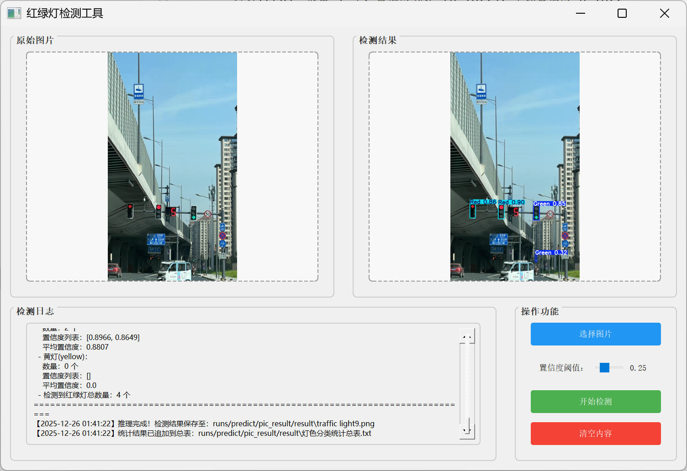
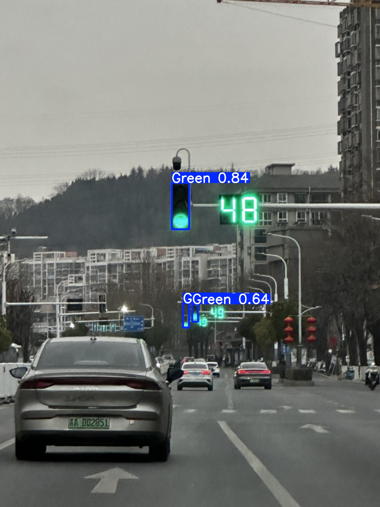
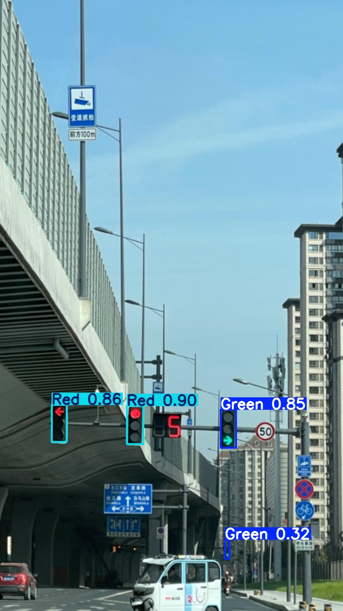
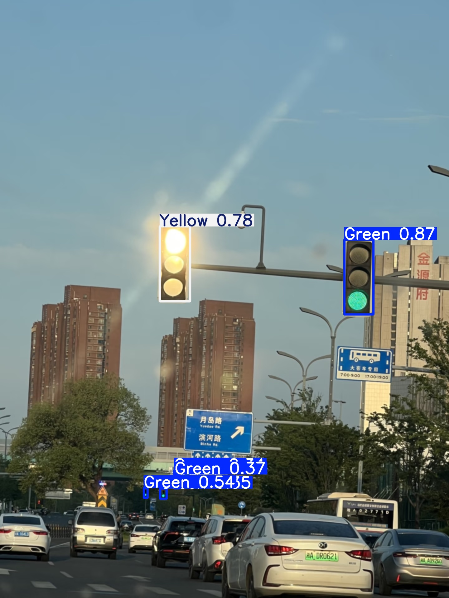

# 基于 YOLOv8 的红绿灯识别系统

## 一、项目简介
本项目是一个集模型训练、图形化界面（GUI）推理于一体的红绿灯识别系统。基于 YOLOv8 目标检测算法，支持多格式图片输入、实时检测结果可视化、置信度阈值调节，可精准识别红、绿、黄三种灯光状态，为智能交通感知提供基础解决方案。

> **💡 运行须知**：
> 1. **模型权重**：本仓库已包含训练好的最优模型权重文件（`best.pt`），克隆项目后可直接运行推理脚本体验，无需重新训练。
> 2. **测试数据**：项目内提供了 `test_images` 文件夹，内含部分示例红绿灯图片，方便快速测试。

## 二、核心功能
1. **支持模型训练**：基于自定义红绿灯数据集，自动完成模型训练与最优权重保存。
2. **图形化推理界面**：通过 PyQt5 实现可视化操作，无需掌握命令行基础即可使用。
3. **多格式图片兼容**：支持 `jpg`、`png`、`jpeg`、`bmp` 格式图片检测，无需格式转换。
4. **结果自动保存**：检测后的带框图片、分类统计总表自动归档至本地，便于后续追溯分析。
5. **阈值灵活调节**：支持 0.1 ~ 0.9 置信度阈值调节，适配不同光照、清晰度环境下的精度需求。

## 三、依赖安装
1. 下载或克隆本项目后，进入项目根目录。
2. 打开终端（或 Anaconda Prompt），执行以下命令一键安装所有依赖：

```bash
pip install -r requirements.txt
```

## 四、项目目录结构

```text
traffic-light-yolov8-detect/
├── test_images/          # 示例测试图片文件夹
├── screenshot/           # 项目效果图（README 展示用）
├── train.py              # 模型训练脚本
├── predict_pic.py        # 带 PyQt5 GUI 的推理脚本
├── data.yaml             # 数据集配置文件
├── requirements.txt      # 依赖清单文件
├── README.md             # 项目说明文档
└── best.pt               # 已训练好的最优模型权重

```

## 五、操作步骤
1. 输入数据准备
数据存放：项目根目录下的 test_images 文件夹中已存放了示例红绿灯图片，您也可以选择本地任意路径的图片。

支持格式：支持 jpg、png、jpeg、bmp，可直接导入检测。

2. 程序运行步骤
打开终端，进入项目根目录，输入以下命令启动图形化推理界面：
python predict_pic.py

3. 结果输出路径
带检测框的图片：自动保存至 runs/predict/pic_result/result/（与原图同名）。

统计总表：记录在 runs/predict/pic_result/result/灯光分类统计总表.txt 中。

(注：项目根目录的 screenshot 文件夹中存放了已完成检测的示例效果图，可直接查看参考)

## 六、界面说明 (GUI 可视化操作流程)
选择图片：点击「选择图片」按钮，从 test_images 文件夹或本地任意路径选择需要检测的图片。

调节阈值：拖动滑块调节「置信度阈值」（默认 0.25）。数值越高，检测条件越严格；可根据图片的清晰度与场景复杂度进行微调。

开始检测：点击「开始检测」后，左侧面板显示原始图片，右侧面板显示带检测框的结果图。其中红框、绿框、黄框对应不同灯光，框旁会标注置信度数值。

清空重置：点击「清空内容」可重置界面，以便重新选择图片进行下一轮检测。

## 七、效果展示

**1. 可视化界面 (PyQt5 GUI)**


**2. 多场景检测效果**



